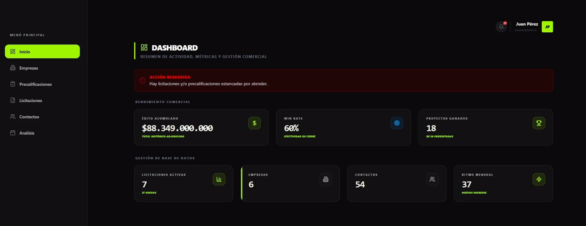
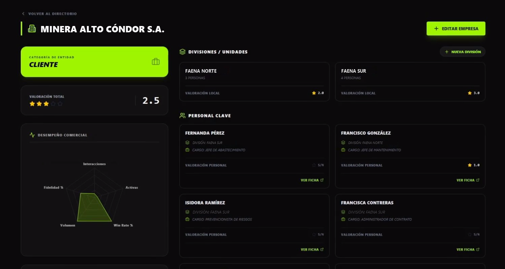
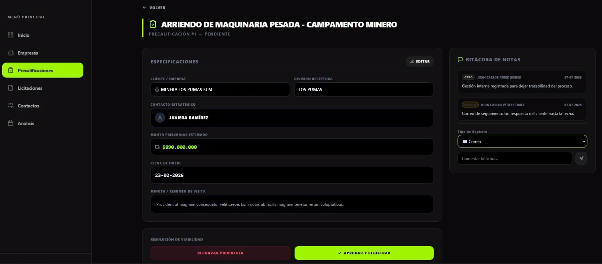
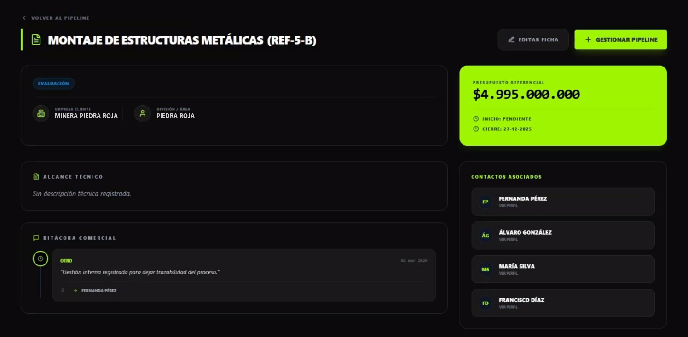
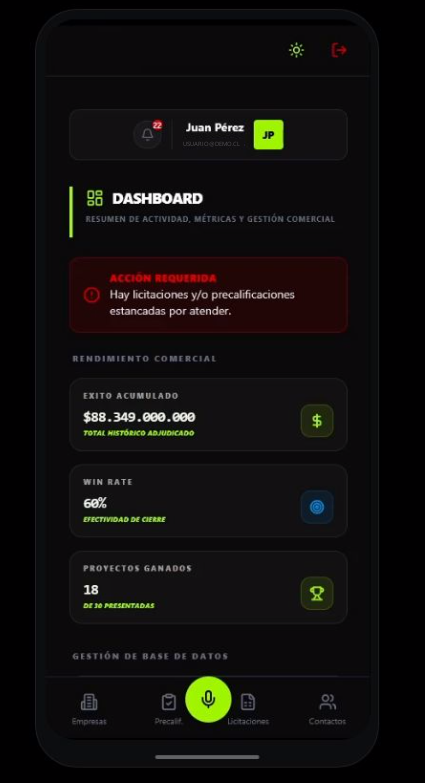
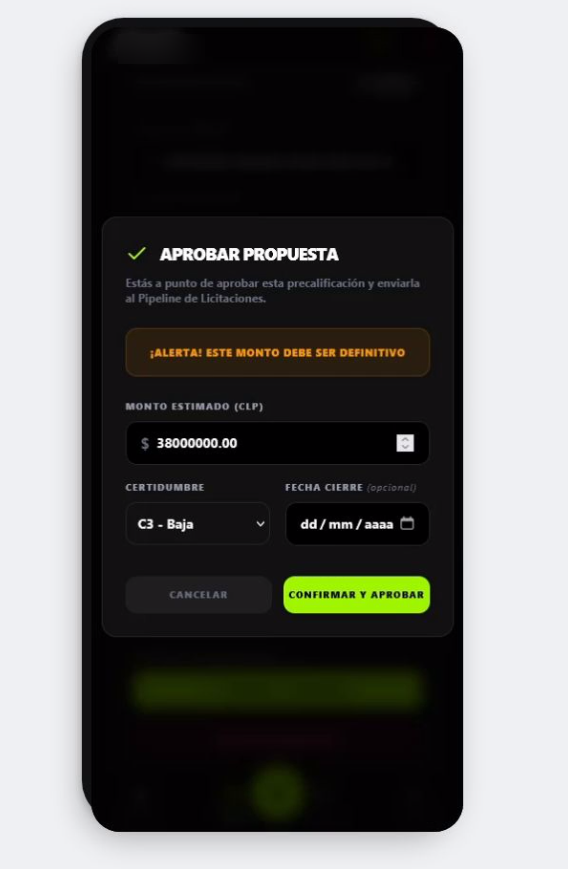
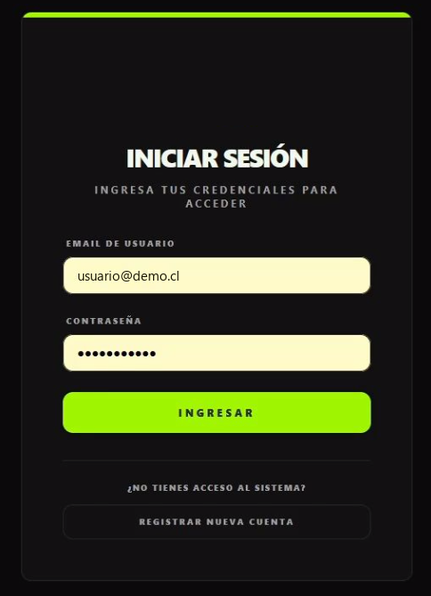

# AVA · Sistema de gestión de contactos y licitaciones

Plataforma web para que el área comercial de **AVA Montajes Industriales** gestione
su red de contactos, sus precalificaciones y el ciclo completo de sus licitaciones,
con un modelo de IA que estima la probabilidad de adjudicación de cada una y un
asistente de voz para actualizarlas sin usar el teclado.

> **Proyecto universidad–empresa.** Desarrollado en equipo para el ramo Taller de
> Ingeniería de Software II (UCSC, primer semestre de 2026), dentro del programa
> Open Innovation AVA. El código y los datos son propiedad de AVA Montajes
> Industriales, por lo que este repositorio solo describe el proyecto y muestra
> capturas con datos de ejemplo.



## Contexto

En el programa Open Innovation AVA, la empresa presentó a estudiantes de último año
de la UCSC desafíos reales de su organización. Nuestro equipo abordó la gestión
comercial: reunir en un solo sistema a las empresas y sus contactos, el seguimiento
de cada licitación desde su evaluación hasta su cierre y las precalificaciones
previas, y dar al equipo comercial información para priorizar dónde poner su
esfuerzo.

El desarrollo se organizó con **Scrum**, en sprints con entregables incrementales.

## Qué hace el sistema

- **Empresas y divisiones:** catálogo de clientes, competencia y subcontratistas,
  con valoración promedio y un gráfico de radar de desempeño (interacciones,
  licitaciones activas, tasa de éxito, volumen de negocio y fidelidad).
- **Contactos:** directorio de personas, su historial laboral entre empresas y la
  bitácora de interacciones con cada una.
- **Pipeline de licitaciones:** vista Kanban con arrastrar y soltar o vista de tabla
  con filtros. Estados: Evaluación, Preparación, Presentada, Adjudicada, Perdida y
  Desierta. Al cerrar una licitación se evalúa al cliente y se registran los
  competidores.
- **Precalificaciones:** evaluaciones previas a una licitación, con bitácora y
  conversión directa a licitación.
- **Alertas:** licitaciones y precalificaciones estancadas.
- **Dashboard:** indicadores comerciales y alertas consolidadas.
- **Predicción con IA:** al crear o editar una licitación, un microservicio calcula
  la probabilidad de adjudicación (0–100 %) a partir del monto, la división, las
  interacciones, la cantidad de competidores, la valoración del cliente y la
  certidumbre.
- **Asistente de voz:** desde cualquier pantalla, un comando hablado cambia el
  estado de una licitación, registra una interacción o anota un competidor. Si el
  comando no se entiende con certeza, no se ejecuta nada.
- **Usuarios y roles:** Admin y Usuario; solo Admin crea cuentas.
- **Diseño responsive:** funciona en escritorio y en el celular, con una barra de
  navegación inferior y el botón del asistente de voz siempre a mano.

## Arquitectura

```
React 19 + TypeScript ──Inertia.js──► Laravel 13 (PHP 8.3) ──► PostgreSQL
  (Tailwind, Radix UI,                  │                       esquemas: usuarios,
   dnd-kit, Recharts)                   │                       crm y laravel
                                        ├──HTTP──► Microservicio IA
                                        │          Python · FastAPI · scikit-learn
                                        └──HTTP──► Groq (Whisper + Llama 3)
                                                   transcripción e interpretación
                                                   de comandos de voz
```

- Una sola base PostgreSQL dividida en **esquemas por dominio**, cada uno con su
  propia conexión en Laravel.
- Los estados del pipeline viven en un único `enum`, que también genera el prompt
  del asistente de voz, para que la interfaz, el backend y la IA no se desalineen.
- El sistema funciona aunque el microservicio de IA no esté disponible: la
  probabilidad simplemente queda sin calcular.

<!-- OPCIONAL, solo con permiso de AVA: diagrama del modelo relacional

-->

## Stack

**Backend:** Laravel 13, PHP 8.3, Sanctum, PostgreSQL, Telescope y Pulse
**Frontend:** React 19, TypeScript, Inertia.js, Tailwind CSS 4, Radix UI, dnd-kit,
TanStack Table y Query, Recharts
**IA:** Python 3.11, FastAPI, scikit-learn, Groq (Whisper y Llama 3)
**Otros:** exportación a Excel y PDF, PHPUnit, Laravel Dusk

## Mi aporte

- **Documentación técnica y funcional del sistema:**
  - **Especificación de requisitos:** 22 requisitos funcionales con sus entradas,
    validaciones y mensajes, además de los requisitos no funcionales.
  - **Manual de instalación:** despliegue completo, incluidos la conexión a
    PostgreSQL y el microservicio de IA.
  - **Manual de usuario:** todos los módulos, roles y el asistente de voz.
  - **Manual de ingeniería:** arquitectura de esquemas, estructura del código,
    control de acceso, deuda técnica y estado de las pruebas.
- **Desarrollo frontend** con React y TypeScript:
  - Indicadores del dashboard (licitaciones activas y nuevas).
  - Formulario de edición de contactos y fichas de contacto y empresa.
  - Utilidades compartidas de formato de fechas.

## Capturas

Todas las capturas usan datos de ejemplo; los nombres de empresas son ficticios.

**Ficha de empresa:** divisiones, personal clave y radar de desempeño comercial.



**Precalificación:** especificaciones, bitácora de notas y resolución de viabilidad.



**Ficha de licitación:** estado en el pipeline, presupuesto, bitácora comercial y
contactos asociados.



**Versión móvil** y **inicio de sesión:**

<p>
  
  
  
</p>

## Equipo

| Integrante | GitHub |
|---|---|
| Camila Rivera | [@mileron](https://github.com/mileron) |
| Cristóbal Alvarado | [@Cr1sseb](https://github.com/Cr1sseb) |
| Bastián Carrillo | [@Sakexxpearex](https://github.com/Sakexxpearex) |
| Manuel Cisternas | [@Maanuus](https://github.com/Maanuus) |

Proyecto desarrollado junto a AVA Montajes Industriales en el marco del programa
Open Innovation AVA de la Universidad Católica de la Santísima Concepción.
